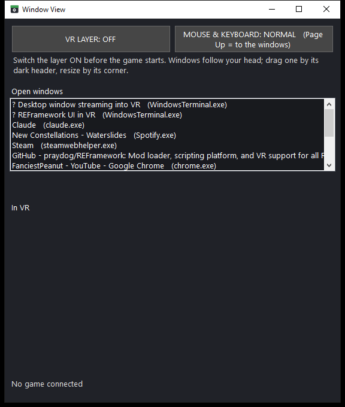
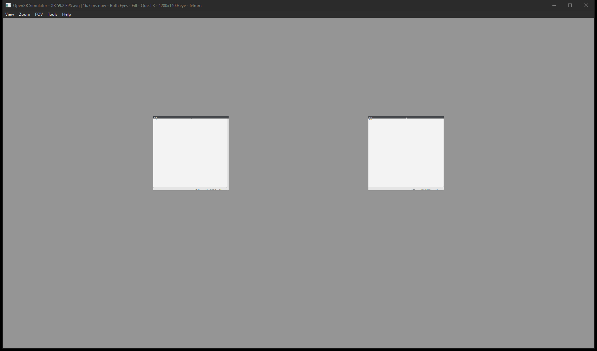

# Window View — see your desktop windows inside any OpenXR game, and use them with the mouse

> 🔧 **Still being worked on, while already in use.** Worn in a real headset since 2026-10-24, in Resident Evil Village
> (Visceral RE8) on Virtual Desktop, and tested on the OpenXR Simulator. Other games have not been tried yet.
> Page Down always hands the mouse and keyboard back; closing the app does too.

 

A small desktop app plus an OpenXR layer. Add any app (say Hand Freeze, or a browser), and its window hangs in front
of your eyes inside the game like an in-game menu, about a metre away, turning with your head. You can add as many
windows as you like, make each one more or less see-through, drag it aside by its dark header and resize it by its
corner, all with the mouse. A switch, **MOUSE & KEYBOARD**, decides who gets your mouse and keyboard: normally the
game, as always; switched on, the windows in VR get them and the game sees nothing, so you play with the motion
controllers or the gamepad while you click and type in the floating windows. **Page Up** switches it on, **Page Down**
off, from anywhere, without the game hearing the key.

Made for tuning our VR mods from inside the headset (2026-10-16): with Hand Freeze holding the controllers still, the
sliders of the hand poser can now be moved without lifting the headset.

## Get it

Download the zip from [Releases](https://github.com/TefMeister/window-view-vr/releases), unzip it, right-click
`install.ps1` and choose **Run with PowerShell**. A **Window View** icon appears on the desktop; no administrator rights
are needed. Or build it yourself: `build.bat` (Visual Studio 2022 Build Tools for the layer; the app uses the C#
compiler that ships with Windows) then `install.ps1`. After an update, open the app once: it checks that the layer
registration still matches the files beside it (the 32-bit copy too) and mends it (v1.1, 2026-10-16, as Hand Freeze
v3.2; an old registration without the 32-bit copy stops 32-bit OpenXR games from starting).

## Use

1. Double-click **Window View** on the desktop and press **VR LAYER: OFF** so it says **ON**. Leave it on.
2. Start the game. The layer must be on **before** the game starts (OpenXR add-ons load at start); a game that was
   already running needs one restart. The bottom line says *Connected: <game>.exe (D3D11)* once the game draws.
3. Press **ADD AN APP...** and pick the app's .exe (or a shortcut to it), or simply drag the app or its shortcut onto
   the Window View window. If the app is not running, it is started. Its window appears in the headset, straight ahead,
   as soon as it opens, and again every time the app is opened later. Each added app gets a row under **IN VR** with
   its own icon, a **See-through** slider, a **Size** slider, a **Show** box and **REMOVE**.
4. Press **Page Up** (or the big button). Now your mouse moves a small arrow across the floating windows and your
   keyboard types into the one you last clicked. The game gets neither. Drag a window by its dark header to move it,
   drag the three little lines in its bottom-right corner to resize it.
5. Press **Page Down** to give the mouse and keyboard back to the game and the desktop.
6. Optional (1.4): press **WINDOWS: FOLLOW MY HEAD** so it says **STAY IN THE ROOM**. The windows then stay where they
   are in your real room, so you can walk up to them, look past them and turn away; they no longer follow your head.
   With the mouse on the windows, **F9** pushes the window under the cursor further away, **F10** pulls it closer (it
   shrinks and grows like a real object), and **F11** brings every window back in front of you. The setting is
   remembered; it starts OFF.
7. Optional (1.5): click the **left thumbstick** in. The controllers now work the windows instead of the game: the game's
   hands stay frozen in their pose (its triggers and grips keep what they were, its buttons and sticks go still), and
   you can walk round them. Point with the right controller: **trigger** clicks (hold it to drag a slider), **A** is the
   right mouse button, the **right stick** scrolls, **Y** brings every window back in front of you. Either **grip**
   picks up the window that hand points at and carries it, one in each hand at once; that hand's stick pushes it away
   or pulls it in. Click the left thumbstick again to give the game its controllers back. While the Hand Poser has sliders
   ticked, X / Y / A / B and the grips step those sliders instead (see the Hand Poser's readme).
8. Optional (1.6): **CONTROLLERS: GAME ONLY** leaves the controllers to the game alone: the windows and the mouse still
   work, the left stick click does nothing for Window View. Use it when the game stops seeing your controllers with Window
   View on (seen once in Village on Virtual Desktop, 2026-10-27). Takes effect at the next game start.
9. New in 1.7: three rows are always in the list. **Window View** itself, its own **Keyboard** and **Lanes** (the Windows
   Terminal window). Each has a Show box; they have no REMOVE. The keyboard types into the
   window you last clicked: point at a key and pull the trigger. Shift and Ctrl hold for the next key only.

Windows come back where you left them next time (matched by program and title), from
`%APPDATA%\WindowViewVR\layout.txt`.

## How it works

- **The layer** (`layer/window_view_layer.cpp`, an OpenXR API layer registered for this Windows user, 64-bit and a
  32-bit copy) sits between the game and the OpenXR runtime. At every `xrEndFrame` it appends one **quad layer** per
  shown window after the game's own layers, in a head-locked (`VIEW`) space, 1 m in front, blended by alpha. The
  pixels come from the app through shared memory; the layer copies a window's picture into a swapchain of its own only
  when it changed. D3D11 (`UpdateSubresource`) and D3D12 (upload buffer + copy on the game's queue) games are supported;
  a Vulkan or OpenGL game shows nothing and the app says so.
- **The app** (`app/*.cs`) does the rest: `Capture.cs` photographs each window about 30 times a second with
  `PrintWindow` (works when the game covers it), puts our header strip above the client area and bakes the opacity
  into the alpha; `Desk.cs` is the imaginary desk in metres with the cursor, the hit test and the layout file;
  `InputRouter.cs` holds two low-level hooks on their own thread: Page Up / Page Down are always swallowed, and while
  on, every mouse and keyboard event is swallowed too. The real cursor is parked at the middle of the screen, the
  hook reads how far the mouse *wanted* to move, and that becomes the desk cursor. Clicks, moves and the wheel are
  posted to the real control under the desk cursor as ordinary window messages; letters go as `WM_CHAR`, other keys
  as `WM_KEYDOWN`/`WM_KEYUP`. The game keeps the Windows focus the whole time, so controllers and the gamepad keep
  working. Closing the app always hands the mouse and keyboard back.
- `shared.h` is the hand-over: one 512-byte header (8 slots: where, how big, which pixel buffer is finished, plus the
  layer's heartbeat, the game's name and graphics API, counters) and one double-buffered BGRA pixel block per slot.

## Tested

On the dev PC with the OpenXR Simulator, 2026-10-16, `[verified-numerically 2026-10-16, n=1 each]`:

- `test/view_test.py` (a stand-in game, `test/xr_test_app.cpp`, and a stand-in app, `test/fake_window.py`): D3D11 and
  D3D12 both PASS: frames ended, the layer named the right API and exe, pictures uploaded, quads submitted, no error;
  a mid-run resize swapped to the new picture. Photos of the preview window show the test picture in both eyes.
- `test/input_test.py` (Notepad in VR through the layout file, the app started with `--test-input`, the real stand-in
  game): Notepad captured and shown, the real cursor stayed parked while on, `hello` typed into Notepad through the
  desk, the window dragged right by its header, the mouse moving again after Page Down. All six PASS.
- A game started with no app running keeps running and shows nothing.

First use in a real headset, home PC, 2026-10-24 (Tefa): two problems, both fixed in v1.2 the same evening, not yet
tried again:

- *"hand poser is not on the list"*: the list of open windows was read only when Window View started, and Hand Poser
  was opened later. It now refreshes by itself every two seconds.
- *"i need to somehow be able to know where my mouse is in vr"*: the cursor was drawn only while it was over a window,
  and could wander almost a metre off into empty space. Now it starts in the middle of the top window, stays within
  3 cm of the windows, is twice the size with a thick outline, and turns yellow on the nearest window's edge while it is
  between windows.

v1.2 worn the same evening, home PC, real headset (Tefa): *"this works really well now!"*

v1.3, 2026-10-25 (Tefa: *"instead of having a list of open apps to choose from, can we have an add window button
instead? ... or simply drag the shortcut to the app window and it would show up?"*): the list of every open window is
gone; apps are added by **ADD AN APP...** or by dropping an app or its shortcut on the window, started if they are not
running, and each row shows the app's own icon. The sliders are drawn by the app itself (the stock Windows slider
flickered white whenever a window was photographed), and the window's background is its new icon, a window with plants
on the sill and a sunny day outside, finely pixelated and still (the scan lines and rolling light came off on 2026-10-25 to spare the headset). Tested
on the home PC: an app picked with **ADD AN APP...** was started and joined the list, and Hand Poser joined by itself when
it was opened. Dropping a shortcut is not yet tried by hand.

1.4, 2026-10-25 (Tefa: *"can the Window view actually leave the windows in place inside the VR headset, so they are
not stuck to my view ... added keyboard keys to push the window back and forward"*): the room mode and F9 / F10 / F11.
The layer puts the windows in the headset's room space around an anchor taken from where the head looks (level, at the
head's height) and turns each to face it; the headset itself holds them still, so they stay steady even when the game
stutters. "In the room" means the real room, not the game world: turning the character with the stick leaves them
where they are. Tested on the OpenXR Simulator, home PC, `[verified-numerically 2026-10-25, n=1 each]`: `view_test.py`
D3D11 and D3D12 PASS in both modes, and with `--room` the layer set its anchor; a photo of the preview with the head
turned 25 degrees showed the window slid aside in perspective, held in the room. Not yet worn in a real headset.

1.5, 2026-10-25 (Tefa: *"can you make it so that i can actually use the motion controllers to do all the tweaking and
slider tuning"*, *"the mouse in VR right now is very laggy"*, *"the sliders to somehow move smoothly not trail behind"*, *"the
ability to grab these windows with LG and RG, two windows at once"*): the controller mode above; the pointer drawn by the
layer itself every headset frame instead of into the window pictures; the window pictures taken with Windows Graphics
Capture (`capture/window_capture.cpp`, no redraw: PrintWindow cost 29-40 ms a picture for the slider apps and the app took
them one after another, so each window got about 12 pictures a second; PrintWindow stays as the fall-back); windows drawn
farthest first, so a nearer one always covers a farther one. The layer adds its own action set for the Touch and Index
controllers beside the game's (appended to the game's own bindings, attached and synced with its set); a profile the game
never suggests is left alone. Tested, home PC, `[verified-numerically 2026-10-25, n=1 each]`: on the OpenXR Simulator a
stand-in game with its own controller actions kept every sync, state and pose working with ours attached beside them
(D3D11 and D3D12), and with the controller mode on the aim ray came through every frame; with the installed app and layer
the pointer landed on the window the simulated controller pointed at; playing the layer's part by hand, the right grip
carried a window exactly as far as the ray moved, and both grips carried a window each at once. Graphics Capture gave the
Hand Poser's client area exactly, a grab costing well under a millisecond. Not yet tried in a real headset.

1.6, 2026-10-27 (Tefa, in Village on Virtual Desktop: *"with the window view on, my controller is not working"*): REFramework
said "using controllers false" for the whole run, on two nights, while Window View's own controller actions worked. Likely
cause `[hypothesis]`: the runtime gives each button to one action, and ours (bound to the same buttons) won. The new switch
**CONTROLLERS: GAME ONLY** (`controllers=0` in settings.txt, read by the layer once at the game's first binding call) adds
no action set and no bindings at all. Tested `[verified-numerically 2026-10-27, n=1 each]`: `view_test.py both --actions
--game-only` PASS (the game's actions all work, the windows still show, the layer reports "left to the game"), and the
default `--actions` still PASS. Not yet tried in the headset.

1.7, 2026-10-28 (Tefa: *"can you make the in-vr keyboard, window view itself and the Lanes window show up in VR headset,
while the window view is on. hold Lthumb for 2 seconds to make window view window in the headset to appear/dissapear"*,
and for the keyboard *"something i can use to type stuff into the windows that window view puts inside the headset"*):
Window View's own window and a new keyboard window (`app/KeysUi.cs`) can be shown in the headset, and Lanes too. The
Lanes desktop shortcut starts `wt.exe`, whose window belongs to `WindowsTerminal.exe`, so before this it never found its
window; its row now looks for any Windows Terminal window. The Windows on-screen keyboard was no use here: it types into
the focused window, and the game keeps the focus. The left stick now counts a click when it is let go before 2 seconds;
held 2 seconds it is a hold, counted in spare bits of the controller block that Hand Poser does not read. Tested on the
home PC `[verified-numerically 2026-10-28, n=1]`: it builds; the installed app opened its window and the keyboard, and
added the three rows; the Lanes row found the terminal window. Not yet tried in the headset.

1.7.1, the same night (Tefa in the headset: *"still can't type into lanes in vr when it's not in focus, and even when in
focus, i don't think the keyboard works"*): Windows Terminal ignores posted key messages, so for a terminal window the
keys now go into the console of the program running in it (`app/ConsoleInput.cs`: attach for a moment, WriteConsoleInput,
let go), the program whose console title is the window's title. Tested `[verified-numerically 2026-10-28, n=1]`: from a
program without a console, 142 keys typed into a throwaway terminal window that never had the focus ran the command they
spelled.

1.7.2, 2026-10-29 (Tefa: *"2 seconds is so long"*): the left stick hold that shows or hides Window View's own window
is half a second now. A shorter press is still a click (the controller mode switch). Builds; not yet tried in the
headset.

1.8, 2026-10-30 (Tefa: *"the keyboard does not register some presses"* and the Show ticks *"are too small and don't work,
clicking them does nothing"*): pulling the trigger tilts the controller, so the pointer slid off a small key or tick between
press and release and the click was lost. Now the pointer holds still from the first touch of the trigger until the ray
moves more than 14 picture pixels (then it follows, so sliders still drag); the keyboard's keys type on the press, not the
release; and the Show tick is a big SHOWN / HIDDEN button that switches on the press. Builds; not yet tried in the headset. The same day: the
window grows to show every row of its list instead of scrolling (up to the screen's height; Tefa: *"so it automatically scales
longer, instead of having to scroll down"*).

1.9, 2026-10-30 (Tefa: *"is it somehow possible to have non laggy windows"*): measured in the headset with RE Village
(D3D12) and six windows: the game ran at 59.5 frames a second instead of 72 while the busiest window (the terminal) sent
32 pictures a second, and the layer waited inside the game's frame for each picture's copy to finish. Each window now
copies with its own command list and nothing waits; a window's copy is only waited for before its own buffer is used
again, a frame or more later. The left-stick hold that showed or hid Window View's own window is gone (Tefa: *"please
remove that feature all together"*); a click still switches the controllers.

## Limits

- **OpenXR games only**, drawing with **D3D11 or D3D12** (all RE Engine games do). Vulkan and OpenGL come later.
- A game that reads the mouse through raw input may still see the mouse while the switch is on; most VR games do not
  care about the mouse at all.
- A program that checks the real mouse buttons instead of its messages may ignore clicks (none seen so far).
- Keyboard shortcuts with Ctrl or Alt go as key presses without the modifier state the program might check.
- Windows' pointer speed setting also scales the desk cursor.
- Games with anti-cheat may refuse OpenXR layers.

## Credit

Built on the same two-part shape as [Hand Freeze](https://github.com/TefMeister/hand-freeze-vr).
OpenXR headers in `third_party/openxr/` are from the Khronos Group's
[OpenXR-SDK](https://github.com/KhronosGroup/OpenXR-SDK) (release-1.1.43, Apache-2.0). The tests use the
[OpenXR Simulator](https://github.com/webhead2oo9/OpenXR-Simulator) by fholger, extended by elliotttate and
webhead2oo9 (MIT), the loader shipped with [pyopenxr](https://github.com/cmbruns/pyopenxr), and Pillow.
[OpenKneeboard](https://github.com/OpenKneeboard/OpenKneeboard) and Desktop+ showed years ago that windows belong in
the headset; this is a smaller tool for one job.

If you should be credited here and are not, open an issue on this repository and it will be fixed.
